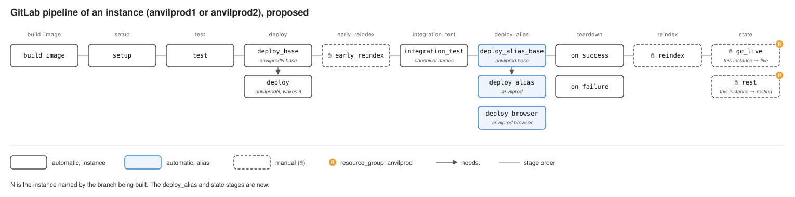

# Blue-green deployments (#6026)

## Problem

Reindexing a stable deployment degrades the service for external users: responses are slow, the index is incomplete, manifests fail, and code deployed ahead of the reindex can fail on documents that haven't been reindexed yet (see the 2026-09-24 recurrence in `prod`). The goal is to reindex out of sight of users and switch over once the new index is complete, without permanently doubling the cost of the deployment.

This design uses `anvilprod` as the example. `prod` would follow the same pattern.

## Terminology

A *deployment* (`anvilprod`) consists of two *instances*, `anvilprod1` and `anvilprod2`. Each instance is in one of three states:

- *live*: serves the public domain names

- *standby*: fully provisioned, reachable only at its canonical domain names

- *dormant*: its expensive resources, most importantly the OpenSearch domain, don't exist

Exactly one instance is live at any time. A live instance is never dormant. Bringing a dormant instance back is called *waking* it.

Each instance has *canonical* domain names, such as `service.1.explore.anvilproject.org`, which always lead to that instance. The deployment has *public* domain names, such as `service.explore.anvilproject.org`, which lead to whichever instance is live.

## Configuration

The deployments that take part set `AZUL_BLUE_GREEN_MODE` to `1`. All other deployments leave it at its default of `0` and behave exactly as before. Its name begins with `AZUL_` so that it is exported to the Lambdas, which need it at runtime (see *Self-referencing URLs*).

When the mode is on, the name of the deployment determines its role. A name without a numeric suffix, such as `anvilprod`, denotes the alias. A name with one, such as `anvilprod1`, denotes the instance of that number. There are always exactly two instances, `1` and `2`. Components take the role of the deployment they belong to: `anvilprod1.base` is the `base` component of instance 1. When the mode is off, a numeric suffix has no meaning, as in the existing personal deployment `hannes2`.

Each of the three deployments has its own `environment.py`, and the environment loader is unchanged. An instance doesn't inherit from the alias's `environment.py`. The three files are kept in sync manually, as is already done for hammerbox and anvilprod, or for a personal deployment and the sandbox it is based on:

- `deployments/anvilprod1/environment.py` and `deployments/anvilprod2/environment.py` must be identical except for `AZUL_DEPLOYMENT_STAGE` and `AZUL_SUBDOMAIN_TEMPLATE`. This is stricter than the relationship between hammerbox and anvilprod: if a promotion that adds a catalog changed only the file of the instance it switches to, the other instance would come back without that catalog when it is woken for the next switch.

- `deployments/anvilprod/environment.py` configures the alias, whose main component needs little more than the domain names. However, the `shared`, `gitlab` and `browser` components inherit from it through the existing component mechanism, so whatever they read must remain in that file.

A unit test enforces the first rule. For every deployment `D` that has `AZUL_BLUE_GREEN_MODE` set to `1` and no numeric suffix, the test loads `env()` from `deployments/D1/environment.py` and `deployments/D2/environment.py`, removes `AZUL_DEPLOYMENT_STAGE` and `AZUL_SUBDOMAIN_TEMPLATE` from both, and asserts that the remainders are equal. It also asserts that both instance directories exist and that both set `AZUL_BLUE_GREEN_MODE` to `1`. A forgotten sync thereby fails the build instead of breaking an instance at the next switch.

## Terraform components

| Component | `anvilprod` | `anvilprod1`, `anvilprod2` |
|---|---|---|
| main | alias mode: public domain names only | full instance |
| `base` | ? | per instance (KMS keys, GCP service account) |
| `shared` | single, as today | — |
| `gitlab` | single, as today | — |
| `browser` | single, deployed by the instance pipelines | — |

In *alias mode*, the main component owns only the public domain names: the ACM certificates, the API Gateway custom domain names and the Route 53 A records. It doesn't own the base path mappings that connect a public custom domain name to an instance's API. Those are maintained by `scripts/manage_blue_green.py` (see *The state jobs*).

The instances' main components are configured like any other main deployment (see *Configuration*), with `AZUL_SUBDOMAIN_TEMPLATE` set to `*.1` or `*.2`, and the same `AZUL_DOMAIN_NAME` as `anvilprod`. All resource names are qualified with `AZUL_DEPLOYMENT_STAGE`, so the two instances don't collide. These files also exist on `develop`. Which instance a build deploys is not configured in the source (see *Branches and pipelines*).

### Why not alias records

Switching the public names by repointing DNS alias records doesn't work with edge-optimized API Gateway custom domain names. A custom domain name can exist only once, so both instances can't own `service.explore.anvilproject.org`. CloudFront also routes by the `Host` header, so a request for the public name reaching the distribution of `service.1.…` would most likely be rejected. This hasn't been tested, but the existing DRS alias also needed a custom domain name of its own, not just a DNS record.

Switching the base path mapping (`update-base-path-mapping` with patch operations on `/restapiId` and `/stage`) avoids that problem. It takes effect without waiting for a DNS TTL to expire, and switching back is the same operation.

### `shared` and the ECR images

`shared` remains single. It mirrors upstream images into ECR and, on every regular `apply`, deletes the images that the current commit doesn't use. The two-phase `shared` deploy that already exists (`apply_keep_unused`, then `apply`) covers this. The second phase may run only from a commit that every instance is on, except for dormant ones.

The Lambda image repository is unaffected. Its tags are qualified with the stage (`anvilprod1-service`, …), and `--delete-unused` doesn't touch it.

## State

The instance states live in a single SSM parameter per deployment, such as `/azul/anvilprod/instances`:

```json
{"live": 1, "standby": false}
```

`live` is the number of the live instance, `1` or `2`, and `standby` says whether the other instance is standby (`true`) or dormant (`false`). These are the only four valid states, and every document of this shape is one of them: exactly one instance is live, and a live instance can't be dormant.

Each transition writes a single field:

| Transition | Write | Precondition |
|---|---|---|
| Run the `wake` job | `standby: true` | — |
| Run the `switch` job | `live: <other>` | `standby` is `true`; the previously live instance becomes standby |
| Run the `rest` job | `standby: false` | — |

Making the live instance dormant can't be expressed, and making a dormant instance live requires waking it first. Every state change is made by `scripts/manage_blue_green.py`, normally through one of three manual GitLab jobs in the `anvilprod` pipeline: `wake`, `switch` and `rest`. The three jobs are placed in the GitLab `resource_group: anvilprod`, which makes GitLab run them one at a time.

SSM is authoritative. The base path mappings are derived from it, and `scripts/manage_blue_green.py` reconciles them with it, so re-running the `switch` job repairs a switch that failed halfway (see *The state jobs*).

### Effect on the `deploy` job in GitLab

The `deploy` job reconciles an instance's resources with its state. For a dormant instance, the OpenSearch domain (and the alarms that depend on it, as in the `_hibernate` convenience function) are omitted from the Terraform configuration, so applying it destroys them. For any other instance, they are created. Making an instance dormant or waking it therefore takes two steps: change the state, then deploy.

The Terraform config templates read the state when they are rendered, and include or exclude resources with a Python conditional, as they already do for, say, `config.is_tdr_enabled()`. Templates already query external state at render time: `lambda_image_uri` asks the registry for an image digest, and the `browser` template asks GitLab for a tarball hash. A conditional in the template leaves the excluded resources out of the generated configuration entirely, which is simpler than an `aws_ssm_parameter` data source with `count`, which would require every reference to the domain to be indexed and guarded in Terraform.

The existing `config.share_opensearch_domain` mode already omits `aws_opensearch_domain.index` and supplies its dependents from elsewhere: the endpoint and instance count in the Lambdas' environment, and the `opensearch_nodes` data source of the CloudWatch dashboard. Dormancy uses the same branch points, but with no endpoint to supply: the Lambdas of a dormant instance get an empty endpoint and fail any request that needs the index. The `cluster_settings` null resource is omitted along with the domain.

Since rendering reads SSM, deploying an instance always applies its current state, regardless of who started it. A pipeline that deploys an instance after the `wake` or `rest` job has changed its state therefore creates or destroys its OpenSearch domain, even if that pipeline was started for some other reason. During a blue-green promotion (see *Blue-green promotions*), the operator runs either job immediately before pushing the merge commit to the GitLab branch named after the affected instance, for example `anvilprod:anvilprod2`, so the pipeline that deploys the instance next is the intended one.

The `integration_test`, `early_reindex` and `reindex` jobs short-circuit for dormant instances.

## Branches and pipelines

Promotion and hotfix PRs target the `anvilprod` branch, as they do today. After the merge, the operator pushes the merge commit to GitLab twice, under different branch names:

```
git push gitlab.anvilprod anvilprod
git push gitlab.anvilprod anvilprod:anvilprod1
```

The name of the branch being built selects the instance:

```python
'azul_shared_deployments': json.dumps({
    …
    'anvilprod': ['anvilprod', 'anvilprod1', 'anvilprod2', 'hammerbox'],
    'anvilprod1': ['anvilprod1'],
    'anvilprod2': ['anvilprod2'],
})
```

The `anvilprod` entry lets local builds on the `anvilprod` branch select any of the three deployments. The other two entries make GitLab deploy the instance named by the branch being built.



| Job | `anvilprod` pipeline | `anvilprod1`, `anvilprod2` pipelines |
|---|---|---|
| `test` | skipped | runs |
| `deploy_base`, `deploy` | alias mode | instance |
| `deploy_browser` | skipped | deploys `anvilprod.browser` |
| `integration_test` | skipped | runs against the canonical names |
| `early_reindex`, `reindex` | absent | manual |
| `wake`, `switch`, `rest` | manual | absent |

Jobs short-circuit based on the configuration (`if python -m azul -t config.deployment.is_alias …`). The manual jobs use `rules:` on `$CI_COMMIT_BRANCH` instead, so that no button appears that does nothing when clicked.

The `test` job runs in the instance pipelines and is skipped in the `anvilprod` pipeline. Hotfixes made during a promotion are committed directly to the `anvilprod` branch and pushed to GitHub and GitLab, so an instance pipeline may be the only one that builds a given commit. Every commit is eventually built by an instance pipeline, so testing it there suffices.

### The `deploy_browser` job

The `deploy_browser` job moves to a stage of its own, between `integration_test` and `teardown`, so that the `browser` component is deployed only after the instance passed the integration test. Placing the stage before `teardown` keeps a failure of the job reflected in the GitHub status check. The job's `needs:` changes from `[build_image, deploy_base, deploy]` to `[build_image, integration_test]`, since `needs:` would otherwise let it start as soon as the `deploy` job finishes, regardless of its stage.

There is only one `browser` component, `anvilprod.browser`. In an instance pipeline, the job removes the numeric suffix from the deployment name to select it. In a blue-green promotion, both instance pipelines deploy the component, but the second time nothing changes.

The Data Browser doesn't inherit Azul's default catalog. Its sites are deployed from the tarballs of the most recent successful Data Browser builds, so deploying the `browser` component from the pipeline of a standby instance doesn't change which catalog the Data Browser defaults to. Making a new catalog the default requires a change to the Data Browser's repository, pushed to GitHub and GitLab. Once the Data Browser build succeeds, the operator retries the `deploy_browser` job in the most recent pipeline of the live instance, which picks up the new tarball. In a blue-green promotion, this must happen after the `switch` job has run, because only the new instance has the new catalog.

### The state jobs

All three state jobs act on the instance that isn't live, so they need no instance number, and they all run in the `anvilprod` pipeline. `wake` and `rest` change no resources: deploying the affected instance next creates or destroys its OpenSearch domain.

A single script, `scripts/manage_blue_green.py`, implements all three jobs, with one subcommand per job. The `Makefile` has a target for each subcommand, `make switch`, `make wake` and `make rest`, and each job runs its target, as the `reindex` job runs `make reindex`. Only the script mutates the state and only the script updates the base path mappings. Each subcommand checks the transition's precondition before making any change. The operator can also run the targets from a local checkout, for example when GitLab is unavailable.

The `switch` subcommand makes the other instance live:

1. If the base path mappings don't match the state, a previous run was interrupted after writing the state. Finish reconciling the mappings with the state, and stop.

2. Refuse unless the other instance is standby, its index is complete, and its canonical names answer `/health/basic`. The index is complete when every catalog's indices exist and the indexer queues are empty. To check, the subcommand reads the other instance's number from SSM and selects that instance's deployment, as the `deploy_base` job selects the `base` component.

3. Record the other instance as live in SSM.

4. Point each public custom domain name's base path mapping at that instance's API and stage.

5. Check `/version` and `/health/basic` through the public names.

The first step makes retrying a failed `switch` job safe: without it, a retry would toggle the state back. The subcommand doesn't require the other instance to be on the same commit, because rolling back switches to an instance on the previous commit.

Since `needs:` can't refer to a job in another pipeline, the `switch` job can't depend on the `integration_test` job of the instance pipeline. The PR checklist has the operator confirm that it passed. Alternatively, the job could look it up through the GitLab API, which requires enabling the `READ_PIPELINES` and `READ_JOBS` fine-grained permissions for the job token.

Running the `switch` job again switches back.

## Integration test

The integration test needs no changes. It runs in the instance's pipeline, with the instance's configuration, so `config.service_endpoint` and `config.indexer_endpoint` resolve to the canonical names, and every AWS resource it touches is qualified with the instance's stage. The OAuth flow in the attended mode of the test redirects to a local HTTP server, so the canonical names don't need to be registered with Google as redirect URIs.

The test doesn't cover the public path, from the public custom domain name through the base path mapping to the instance. The check at the end of the `switch` job and the QC period cover it.

## Self-referencing URLs

During a request, the service derives its base URL from the `Host` header (`AzulChaliceApp.base_url`). A user who calls the public name receives public URLs, and the integration test, which calls the canonical name, receives canonical ones. This needs no changes.

Outside a request, `base_url` falls back to `config.lambda_endpoint`, which will be the canonical name. The compact and curl manifests use that fallback: they are generated in Step Functions and embed `/repository/files` URLs. Users would receive manifests that refer to the canonical name, and those URLs would break once that instance becomes dormant after a later switch.

The fix is to capture the base URL of the request that starts the manifest's Step Functions execution, include it in the `ManifestKey` (and therefore in the manifest hash), and have `generate()` build its URLs from the key rather than from `app.base_url`. Including the base URL in the hash also keeps a manifest generated on a standby instance from being served from the cache after the `switch` job has run. Taking the value from the key also prevents a race with the `switch` job between starting the execution and generating the manifest.

Any other code that builds URLs outside of a request would read the SSM parameter (with a short cache) and use the public name when its instance is live and the canonical name otherwise. Whether any such code exists besides the manifest generators hasn't been checked.

URLs that refer to state held by one instance, such as cached manifest objects and manifest fetch tokens, break after a switch no matter which name they use, because each instance has its own storage bucket. How long such URLs need to stay valid limits how soon the old instance may be made dormant.

## Promotions

A promotion switches instances if it requires a full reindex, a catalog-wide reindex, or the addition of a catalog. A catalog-wide reindex affects the performance that all external users observe, and so does adding a catalog. Every other promotion, and every hotfix, is deployed to the live instance in place.

The `reindex:` labels currently can't distinguish a catalog-wide reindex from a partial one: `reindex:partial` covers both. A `reindex:catalog` label or a narrower definition of `reindex:partial` is needed.

A dormant instance comes back without any OpenSearch indices, so a switch always indexes every catalog from scratch. Adding `anvil17` to a deployment with `anvil16` means indexing both. That is acceptable for now. Restoring an unchanged catalog's indices from a snapshot of the live domain would be an optimization for promotions that change neither the index schema nor the aggregation logic.

### In-place promotions

Precondition: the other instance is dormant. This rules out an in-place promotion during the QC period of a switch.

1. Phase 1 of the `shared` deploy (`apply_keep_unused`)

2. Merge, push `anvilprod`

3. Push `anvilprod:anvilprodL`, where L is the live instance

4. Partial reindex in the `anvilprodL` pipeline, if one is required

5. Phase 2 of the `shared` deploy (`apply`). The dormant instance's Lambda images aren't in the mirrored repositories, and it will be brought to the current commit before it is woken.

### Blue-green promotions

L is the live instance, S the dormant instance that becomes live.

1. Phase 1 of the `shared` deploy (`apply_keep_unused`)

2. Merge, push `anvilprod`

3. Run the `wake` job in the `anvilprod` pipeline

4. Push `anvilprod:anvilprodS`. The `deploy` job creates the OpenSearch domain, and the `integration_test` job runs.

5. Run the `early_reindex` or `reindex` job in the `anvilprodS` pipeline

6. Run the `switch` job in the `anvilprod` pipeline

7. QC period. L is still on the previous commit with a complete index, so rolling back is a matter of running the `switch` job again in the latest `anvilprod` pipeline.

8. Run the `rest` job in the `anvilprod` pipeline, then push `anvilprod:anvilprodL`. The `deploy` job destroys L's OpenSearch domain, and the `integration_test` job short-circuits. This is the point of no return. After it, rolling back requires another switch.

9. Phase 2 of the `shared` deploy (`apply`). All instances and `shared` are on the same commit.

## PR templates

The steps are spelled out verbatim, with instance names, in one template per instance and mode, for example:

- `anvilprod1-promotion.md`, `anvilprod2-promotion.md`: in place
- `anvilprod1-switch.md`, `anvilprod2-switch.md`: switch to that instance
- `anvilprod1-hotfix.md`, `anvilprod2-hotfix.md`

All of them still say "Target branch is `anvilprod`". `scripts/pull_request.py` already derives the template from the name of the promotion branch (`promotions/<date>-<name>` → `<name>-promotion.md`) and the target branch from the item in the template, so a branch name such as `promotions/2026-11-21-anvilprod2` works without changes to the script. The template generator needs reworking: it derives the file name and the target deployments from the target branch (`T.target_branch_by_path`, `T.target_deployments`), which would have to be keyed by instance instead.

## Open questions

- Canonical domain names: `service.1.explore.anvilproject.org` (`*.1`) or `service.anvilprod1.explore.anvilproject.org` (`*.{AZUL_DEPLOYMENT_STAGE}`, the convention used by hammerbox)

- Does the alias-mode `anvilprod` need a `base` component, or do only the instances have one?

- Naming of the templates and of the promotion branches that select them

- Alarms and scheduled Lambdas of a dormant instance. Its Lambdas and API remain, but requests to them fail without an OpenSearch domain.

- Whether the public custom domain names behave as assumed, specifically that the base path mapping of an edge-optimized custom domain name can be switched between two APIs in the same account and region without downtime

- Other code paths outside of a request that hand out URLs

- Do the Data Browser or Swagger UI need the canonical names registered as OAuth redirect URIs, for use against a standby instance?

- Contents and duration of the QC period

- Migration of the existing `anvilprod` main component into `anvilprod1`, and of its public domain names into the alias-mode component, without downtime

- `reindex:` label for catalog-wide reindexing
