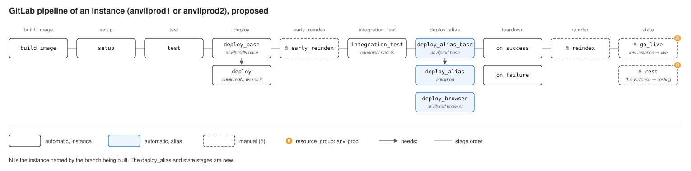

# Blue-green mode deployments (#6026)


## Problem

Reindexing a stable deployment degrades the service for external users: responses are slow, the index is incomplete, manifests fail, and code deployed ahead of the reindex can fail on documents that haven't been reindexed yet (see the 2026-09-24 recurrence in `prod`). The goal is to reindex out of sight of users and switch over once the new index is complete, without permanently doubling the cost of the deployment.

This design uses `anvilprod` as the example. `prod` would follow the same pattern.


## Terminology

A *deployment* (`anvilprod`) consists of two *instances*, `anvilprod1` and `anvilprod2`. Each instance is in one of three states:

- *live*: serves the public domain names

- *standby*: fully provisioned, reachable only at its canonical domain names

- *resting*: its expensive resources, most importantly the OpenSearch domain, don't exist

Exactly one instance is live at any time. A live instance never rests. Deploying a resting instance *wakes* it.

Each instance has *canonical* domain names, such as `service.1.explore.anvilproject.org`, which always lead to that instance. The deployment has *public* domain names, such as `service.explore.anvilproject.org`, which lead to whichever instance is live.


## Configuration

The deployments that take part set `azul_blue_green_mode` to `1`. All other deployments leave it at its default of `0` and behave exactly as before. Only the scripts, the Terraform config templates and the GitLab jobs read it. The Lambdas don't, so its name is lowercase, which keeps it from being exported to them (see *Self-referencing URLs*).

When the mode is on, the name of the deployment determines its role. A name without a numeric suffix, such as `anvilprod`, denotes the alias. A name with such a suffix, e.g., `anvilprod1`, denotes the instance of that number. There are always exactly two instances, `1` and `2`. Components take the role of the deployment they belong to: `anvilprod1.base` is the `base` component of instance 1. When the mode is off, a numeric suffix has no meaning, as in the existing personal deployment `hannes2`. During the migration, the instances are in blue-green mode while the alias isn't yet (see *Migration*).

Each of the three deployments has its own `environment.py`. The three files are kept in sync manually, as is already done for hammerbox and anvilprod, or for a personal deployment and the sandbox it is based on:

- `deployments/anvilprod1/environment.py` and `deployments/anvilprod2/environment.py` must be identical except for `AZUL_DEPLOYMENT_STAGE` and `AZUL_SUBDOMAIN_TEMPLATE`. This is stricter than the relationship between hammerbox and anvilprod: if a promotion that adds a catalog changed only the file of the instance it switches to, the other instance would come back without that catalog when it is woken for the next switch.

- `deployments/anvilprod/environment.py` configures the alias, whose main component needs little more than the domain names. However, the `shared`, `gitlab` and `browser` components inherit from it through the existing component mechanism, so whatever they read must remain in that file.

A unit test enforces the first rule. For every pair of instance directories `deployments/D1` and `deployments/D2` that set `azul_blue_green_mode` to `1`, the test loads `env()` from both `environment.py` files, removes `AZUL_DEPLOYMENT_STAGE` and `AZUL_SUBDOMAIN_TEMPLATE` from both, and asserts that the remainders are equal. It also asserts that `deployments/D` exists. A forgotten sync thereby fails the build instead of breaking an instance at the next switch.


## Terraform components

| Component | `anvilprod` | `anvilprod1`, `anvilprod2` |
|---|---|---|
| main | alias mode: public domain names | full instance |
| `base` | APAT KMS key, user tables | manifest KMS key, HMAC key, GCP service account |
| `shared` | single, as today | — |
| `gitlab` | single, as today | — |
| `browser` | single | — |

The alias's main, `base` and `browser` components are deployed by the instance pipelines (see *Deploying the alias*). `shared` and `gitlab` are deployed manually, as today.

In *alias mode*, the main component owns only the public domain names (the ACM certificates, the API Gateway custom domain names and the Route 53 A records). It doesn't own the base path mappings that connect a public custom domain name to an instance's API. Those are maintained by `scripts/manage_blue_green.py` (see *The state jobs*).

The instances' main components are configured like any other main deployment (see *Configuration*), with `AZUL_SUBDOMAIN_TEMPLATE` set to `*.1` or `*.2`, and the same `AZUL_DOMAIN_NAME` as `anvilprod`. All resource names are qualified with `AZUL_DEPLOYMENT_STAGE`, so the two instances don't collide. These files also exist on `develop`. Which instance a build deploys is not configured in the source (see *Branches and pipelines*).

### `shared` and the ECR images

`shared` remains single. It mirrors upstream images into ECR and, on every regular `apply`, deletes the images that the current commit doesn't use. The two-phase `shared` deploy that already exists (`apply_keep_unused`, then `apply`) covers this. The second phase may run only from a commit that every instance is on, except for resting ones.

The Lambda image repository is unaffected. Its tags are qualified with the stage (`anvilprod1-service`, …), and `--delete-unused` doesn't touch it.

### Mirror buckets

anvilprod mirrors open-access files to an external bucket (`AZUL_MIRROR_BUCKET`), which both instances share. Each instance also provisions its own open-access and managed-access mirror buckets. The integration test catalogs are always mirrored to those, and since `AZUL_MANAGED_ACCESS_MIRROR_BUCKET` isn't set, so are the managed-access files of the other catalogs. These buckets hold only test data, so keeping one set per instance costs next to nothing, and copying the files anew when an instance wakes is cheap.

Sharing the provisioned buckets between the instances would mix the test data of both instances' integration tests, which may run concurrently. An external managed-access bucket would also require adding it to the boundary policy of the `gitlab` component, which currently permits only the provisioned buckets and `AZUL_MIRROR_BUCKET`.

### User state

User state belongs to the deployment, not to an instance, so that a switch doesn't sign users out or invalidate their APATs. It consists of the `users` and `access_tokens` DynamoDB tables and the KMS key that signs APATs, all of which `anvilprod.base` owns. Confining the resources that the alias owns and the instances use to the `base` component means that the instances depend only on the alias's `base` component, not on its main component. In blue-green mode, `config.dynamo_user_table_name`, `config.dynamo_access_token_table_name` and the alias of `config.apat_kms_key` use the name of the deployment instead of that of the instance, so that both instances use the same tables and key. The IAM policies of the Lambdas are derived from the same properties and follow suit.

The user tables move from the main component into the `base` component in every deployment, regardless of the mode. No other resource of the main component refers to them: the IAM policies refer to the tables by name. The move uses `removed` blocks that don't destroy the tables in the main component, and `import` blocks in the `base` component, as was done when the KMS keys moved into the `base` component. Only the user tables move. The source and object cache tables remain in the main component.

The other state remains specific to each instance: the manifest KMS key, the HMAC key, the source and object caches, and the storage bucket. Signed manifest keys refer to an instance's storage bucket anyway.

During the QC period of a blue-green promotion, the two instances run different commits and read and write the same user records. A change to the format of these records must therefore remain readable by the previous commit for one promotion, so that rolling back works.


## State

The state is the number of the live instance, `1` or `2`, in an SSM parameter per deployment, such as `/azul/anvilprod/live`. Whether the other instance is standby or resting isn't recorded: it is resting if its OpenSearch domain doesn't exist.

SSM is authoritative. The base path mappings are derived from it, and `scripts/manage_blue_green.py` reconciles them with it, so re-running the `go_live` job repairs a switch that failed halfway (see *The state jobs*).

### Resting and waking

The `rest` job destroys the OpenSearch domain of the instance of the pipeline it runs in, together with its cache-health alarms. It does so with a targeted `terraform destroy` of the same resources that the main-component part of the `_hibernate` convenience function destroys, which is used routinely in tempdev. A targeted destroy also destroys any resources that depend on its targets.

Waking is implicit. Deploying a resting instance recreates whatever the `rest` job destroyed, so pushing to the branch of a resting instance (see *Branches and pipelines*) wakes it. The `deploy` job doesn't read the state, and the Terraform configuration of an instance doesn't depend on it.

### Switching the base path mappings

Switching the base path mapping of an edge-optimized custom domain name from one REST API to another in the same account and region causes no downtime, but takes up to about 80 seconds to propagate (see *How we tested the base path mapping switch*). For about 40 seconds after the call, every request still reaches the old API. For the next 30 to 40 seconds, either API may answer, presumably depending on which CloudFront server handles the request. After that, only the new API answers.

The `go_live` job therefore polls the public names until only the new instance answers, with a timeout of a few minutes. For about half a minute after the job ran, consecutive requests from the same client may be served by different instances.


## Branches and pipelines

The `anvilprod` branch is retired. Instead, each instance has a branch named after it, `anvilprod1` and `anvilprod2`, on both GitHub and GitLab. A promotion or hotfix PR targets the branch of the instance it is deployed to: an in-place promotion or a hotfix targets the branch of the live instance, a blue-green promotion that of the resting instance. After merging the PR, the operator pushes the branch to GitLab:

```
git push gitlab.anvilprod anvilprod1
```

The history of each branch on GitHub records which commits were deployed to the instance, and when. The tip of a branch is the commit last deployed to the instance, whether the instance is live, standby or resting. Which instance is live is recorded in SSM.

Merging a promotion into the branch of the resting instance brings that branch up to date, even though it may lag behind by several promotions: the promotion branch is based on `develop`, into which every hotfix is backported before the next promotion. The diff of a blue-green promotion PR is correspondingly larger than that of an in-place one. Both branches only ever move forward, so they are protected against force pushes and deletion, as the `anvilprod` branch is today.

The name of the branch being built selects the instance:

```python
'azul_shared_deployments': json.dumps({
    …
    'anvilprod1': ['anvilprod1', 'anvilprod', 'hammerbox'],
    'anvilprod2': ['anvilprod2', 'anvilprod', 'hammerbox'],
})
```

The first entry of each list is the instance that GitLab deploys when it builds the branch. The `anvilprod` entries let the operator select the alias in a checkout of either branch, for example to deploy the `shared` and `gitlab` components, and `hammerbox` remains the sandbox for PRs that target either branch.

Everything that names the `anvilprod` branch must name the instance branches instead, such as `azul_shared_deployments`, `T.target_deployments` in the generator of the PR templates, the names of promotion branches, backports of hotfixes, and checks of whether a commit has reached a stable branch. The latter look at the branch of the live instance.

In blue-green mode, every pipeline is an instance pipeline. It tests the commit before deploying anything, including the alias's components, which matters because hotfixes made during a promotion are committed directly to the instance's branch and pushed to GitHub and GitLab.



| Stage | Jobs |
|---|---|
| `test` | `test` |
| `deploy` | `deploy_alias_base`, `deploy_alias`: the alias's `base` and main components; `deploy_base`, `deploy`: the instance |
| `early_reindex` | `early_reindex` (manual) |
| `integration_test` | `integration_test`, against the canonical names |
| `teardown` | `on_success`, `on_failure` |
| `reindex` | `reindex` (manual) |
| `state` | `go_live`, `rest` (manual) |
| `deploy_browser` | `deploy_browser` (manual): the alias's `browser` component |

### GitLab configuration

The GitLab configuration moves from `.gitlab-ci.yml` into the `.gitlab` directory, and is rendered from templates, as the PR templates in the `.github` directory already are. `make -C .gitlab` renders three files:

- `.gitlab/single.yml`, the pipeline of deployments in single mode, which is today's pipeline

- `.gitlab/blue-green.yml`, the pipeline of the instances of deployments in blue-green mode, as shown above

- `.gitlab/stub.yml`, which replaces `.gitlab-ci.yml` and includes one of the other two, depending on the branch being built

The stub includes `blue-green.yml` for the branch of every instance, that is, every deployment with a numeric suffix that sets `azul_blue_green_mode` to `1`, and `single.yml` for all other branches. It looks at the instances rather than the alias, because during the migration, the instances are in blue-green mode before the alias is:

```yaml
include:
  - local: .gitlab/blue-green.yml
    rules:
      - if: $CI_COMMIT_BRANCH =~ /^(anvilprod)[12]$/
  - local: .gitlab/single.yml
    rules:
      - if: $CI_COMMIT_BRANCH !~ /^(anvilprod)[12]$/
```

The template derives the names of the deployments from their configuration. A generic pattern like `[12]$` would also match feature branches that happen to end in a digit. Since each pipeline is defined for one mode only, no job needs to be excluded depending on the mode, and no `needs:` refers to a job that might be absent. The only job that short-circuits depending on the mode is described in *Deploying the alias*.

The rendered files are committed. GitHub CI checks their freshness by rendering them and asserting that the working copy is clean afterwards.

The project setting *CI/CD configuration file* of every GitLab instance changes from `.gitlab-ci.yml` to `.gitlab/stub.yml`. The setting applies to all branches of the project, so a branch that doesn't contain the `.gitlab` directory yet fails to build once it is changed. The PR that introduces the directory therefore instructs the operator to change the setting on the GitLab instance before pushing the PR branch to it, and to change it back if the sandbox build fails. The setting on the GitLab instances of the stable deployments is changed when the PR is promoted to them.

### Deploying the alias

Three jobs deploy the alias's components: `deploy_alias_base` deploys `anvilprod.base`, `deploy_alias` deploys the alias-mode main component `anvilprod`, and `deploy_browser` deploys `anvilprod.browser`. Each job removes the numeric suffix from the name of the deployment being built to select its component. The jobs need names of their own because job names must be unique within a pipeline, and the instance's `deploy_base` and `deploy` jobs already exist. `deploy_alias_base` and 
`deploy_alias` short-circuit while the alias isn't in blue-green mode, which is the case only during the migration (see *Migration*).

To short-circuit, each of the two jobs selects the alias's component, for example with `_set_deployment anvilprod.base`, and checks the alias's configuration with `python -m azul -t config.blue_green_mode`, as the `test` job checks `config.deployment.is_lower_sandbox`. If the alias isn't in blue-green mode, the job exits successfully before running Terraform. `config.blue_green_mode` is a new property that reflects `azul_blue_green_mode`. The check is needed only for as long as some deployment remains to be migrated, but it also guards against the alias's mode being switched off by mistake, in which case the instance pipelines would otherwise apply the configuration of a full main deployment to `anvilprod`.

`deploy_alias_base` and `deploy_alias` run in the `deploy` stage, before the instance's `deploy_base`. The instance depends on the user state that the alias's `base` component owns (see *User state*): the instance's main component looks up the APAT key with a data source, and the integration test needs the user tables. The `go_live` job depends on the alias's main component, whose public custom domain names it maps to the instance. Deploying the alias's main component changes nothing about which instance serves users, because the base path mappings aren't managed by Terraform, and the integration test, which uses the canonical names, wouldn't exercise it anyway.

`deploy_browser` is a manual job in a stage of its own, after the `state` stage, and is placed in the GitLab `resource_group: anvilprod`. The `browser` component configures what users of the Data Browser get, for example its response headers, so it should change only along with the instance serving them. The operator runs the job in the pipeline of the live instance at the end of an in-place promotion or hotfix, and after the `go_live` job in a blue-green one. Being manual, a failure of the job isn't reflected in the GitHub status check, so the operator checks its outcome.

Both instance pipelines deploy the alias's components, possibly from different commits, for example when a hotfix is pushed to the previously live instance during the QC period of a blue-green promotion. This is harmless as long as the two commits configure the public domain names and the user tables the same way, because the base path mappings aren't managed by Terraform.

The Data Browser doesn't inherit Azul's default catalog. Its sites are deployed from the tarballs of the most recent successful Data Browser builds, so deploying the `browser` component from the pipeline of a standby instance doesn't change which catalog the Data Browser defaults to. Making a new catalog the default requires a change to the Data Browser's repository, pushed to GitHub and GitLab. Once the Data Browser build succeeds, the operator runs the `deploy_browser` job in the most recent pipeline of the live instance, which picks up the new tarball. In a blue-green promotion, this must happen after the `go_live` job has run, because only the new instance has the new catalog.

### The state jobs

The `go_live` and `rest` jobs are manual jobs in the `state` stage of every instance pipeline. Both are placed in the GitLab `resource_group: anvilprod`, which makes GitLab run them one at a time.

A single script, `scripts/manage_blue_green.py`, implements both jobs, with one subcommand per job. The `Makefile` has a target for each subcommand, `make go_live` and `make rest`, and each job runs its target, as the `reindex` job runs `make reindex`. Only the script mutates the state and only the script updates the base path mappings. Each subcommand checks its precondition before making any change. The operator can also run the targets from a local checkout, for example when GitLab is unavailable.

The `go_live` subcommand makes the instance of the pipeline it runs in live:

1. Refuse unless the public custom domain names exist, the instance's index is complete, and its canonical names answer `/health/basic`. The public custom domain names exist once the `deploy_alias` job has run. The index is complete when every catalog's indices exist and the indexer queues are empty. The job's `needs: [integration_test]` ensures that the integration test passed.

2. Record the instance as live in SSM.

3. Point each public custom domain name's base path mapping at the instance's API and stage.

4. Poll `/version` and `/health/basic` through the public names until only the instance answers, for up to a few minutes (see *Switching the base path mappings*).

Running the `go_live` job again is harmless, and repairs a run that was interrupted after step 2. The subcommand doesn't require the other instance to be on the same commit, because rolling back makes an instance on the previous commit live.

The `rest` subcommand makes the instance of the pipeline it runs in rest. It refuses if the instance is live, and destroys the instance's OpenSearch domain as described in *Resting and waking*. The operator runs the job in the most recent pipeline of the instance, which was built from the commit that last deployed it. The targeted destroy therefore uses the same Terraform configuration and provider versions as the instance's Terraform state. That pipeline may be old, and its job image, tagged with the pipeline's ID, must still be in the GitLab registry. If it isn't, the operator runs `make rest` from a local checkout of that commit instead.


## Integration test

The integration test needs no changes. It runs in the instance's pipeline, with the instance's configuration, so `config.service_endpoint` and `config.indexer_endpoint` resolve to the canonical names, and every AWS resource it touches is qualified with the instance's stage. The OAuth flow in the attended mode of the test redirects to a local HTTP server, so the canonical names don't need to be registered with Google as redirect URIs.

The test doesn't cover the public path, from the public custom domain name through the base path mapping to the instance. The check at the end of the `go_live` job and the QC period cover it.


## Self-referencing URLs

During a request, the service derives its base URL from the `Host` header (`AzulChaliceApp.base_url`). A user who calls the public name receives public URLs, and the integration test, which calls the canonical name, receives canonical ones. This needs no changes.

Outside a request, `base_url` falls back to `config.lambda_endpoint`, which will be the canonical name. The compact and curl manifests use that fallback: they are generated in Step Functions and embed `/repository/files` URLs. Users would receive manifests that refer to the canonical name, and those URLs would break once that instance rests after a later switch.

The fix is to capture the base URL of the request that starts the manifest's Step Functions execution, include it in the `ManifestKey` (and therefore in the manifest hash), and have `generate()` build its URLs from the key rather than from `app.base_url`. Including the base URL in the hash also keeps a manifest generated on a standby instance from being served from the cache after the `go_live` job has run. Taking the value from the key also prevents a race with the `go_live` job between starting the execution and generating the manifest.

The manifest generators are the only code that hands out URLs to users outside of a request (see *Which code builds URLs outside of a request*). The deployed code therefore never needs to know which instance is live, and the Lambdas don't read the state.

URLs that refer to state held by one instance, such as cached manifest objects and manifest fetch tokens, break after a switch no matter which name they use, because each instance has its own storage bucket. How long such URLs need to stay valid limits how soon the old instance may rest.


## Sign-in

The Data Browser obtains tokens through `/user/authorize` using Google's authorization code flow in a popup, for which the redirect URI is `postmessage`. Google checks the Data Browser's origin against the OAuth client's authorized JavaScript origins, and that origin doesn't change. The Data Browser only uses the public names, so nothing needs to be registered for the instances.

The Swagger UI uses the authorization code flow, with `/user/authorize` as the token URL and `{base URL}/swagger/oauth2-redirect.html` as the redirect URI. The base URL comes from the `Host` header, so signing in to the Swagger UI of an instance at its canonical name requires that name's redirect URI to be registered with the OAuth client of the deployment. The redirect URIs of both instances, such as `https://service.1.explore.anvilproject.org/swagger/oauth2-redirect.html`, are registered once, in addition to the one for the public name. This lets the operator try authenticated endpoints on a standby instance before the `go_live` job has run.

Both instances use the same OAuth client ID (`AZUL_GOOGLE_OAUTH2_CLIENT_ID`), and therefore the same client secret. In blue-green mode, `config.oauth2_client_secret_path()` uses the name of the deployment instead of the name of the instance, so that both instances read the one secret `dcp/azul/anvilprod/service/google_oauth2_client_secret`. That is where the secret already resides, and the service Lambda may already read any secret in the account. Secrets that the `base` component provisions, such as the HMAC key and the credentials of the Google service accounts, remain specific to each instance.


## Promotions

A promotion switches instances if it requires a full reindex, a catalog-wide reindex, or the addition of a catalog. A catalog-wide reindex affects the performance that all external users observe, and so does adding a catalog. Every other promotion, and every hotfix, is deployed to the live instance in place.

The `reindex:` labels currently can't distinguish a catalog-wide reindex from a partial one: `reindex:partial` covers both. A `reindex:catalog` label or a narrower definition of `reindex:partial` is needed.

A resting instance wakes without any OpenSearch indices, so a switch always indexes every catalog from scratch. Adding `anvil17` to a deployment with `anvil16` means indexing both. That is acceptable for now. Restoring an unchanged catalog's indices from a snapshot of the live domain would be an optimization for promotions that change neither the index schema nor the aggregation logic.

### In-place promotions

Precondition: the other instance is resting. This rules out an in-place promotion during the QC period of a switch.

1. Phase 1 of the `shared` deploy (`apply_keep_unused`)

2. Merge into `anvilprodL`, where L is the live instance, and push `anvilprodL` to GitLab

3. Partial reindex in the `anvilprodL` pipeline, if one is required

4. Run the `deploy_browser` job in the `anvilprodL` pipeline

5. Phase 2 of the `shared` deploy (`apply`). The resting instance doesn't use the mirrored images, and it will be deployed from the then-current commit when it wakes.

### Blue-green promotions

L is the live instance, S the resting instance that becomes live.

1. Phase 1 of the `shared` deploy (`apply_keep_unused`)

2. Merge into `anvilprodS` and push `anvilprodS` to GitLab. The `deploy` job wakes S, and the `integration_test` job runs.

3. Run the `early_reindex` or `reindex` job in the `anvilprodS` pipeline

4. Run the `go_live` job in the `anvilprodS` pipeline

5. Run the `deploy_browser` job in the `anvilprodS` pipeline

6. QC period. L is still on the previous commit with a complete index, so rolling back is a matter of running the `go_live` and `deploy_browser` jobs in the latest `anvilprodL` pipeline.

7. Run the `rest` job in the latest `anvilprodL` pipeline. L rests on the previous commit. Rolling back after this step requires waking L by pushing to its branch, and reindexing it.

8. Phase 2 of the `shared` deploy (`apply`). Every instance that isn't resting is on the current commit.

### AnVIL releases

An AnVIL release adds a catalog, say `anvil17`, and later removes its predecessor, `anvil16`. L is the live instance, S the resting one.

1. A blue-green promotion or hotfix to S adds `anvil17`. S wakes and indexes both `anvil16` and `anvil17` from scratch.

2. The `go_live` and `deploy_browser` jobs run in the `anvilprodS` pipeline. `anvil16` remains the default catalog, so users notice no change.

3. Once the QC of the switch passes, the `rest` job runs in the latest `anvilprodL` pipeline.

4. Internal users preview `anvil17` by appending `?catalog=anvil17` to the Data Browser URL.

5. Once they approve the release, a change to the Data Browser's repository makes `anvil17` its default catalog, and the operator runs the `deploy_browser` job in the latest `anvilprodS` pipeline again (see *Deploying the alias*).

6. An in-place promotion or hotfix to S removes `anvil16` and makes `anvil17` the default catalog of Azul. Removing a catalog only deletes indices, so it requires no switch. Should the release be rejected instead, `anvil17` is removed the same way.

The preview follows the `go_live` job because the Data Browser only uses the public names. It has no easy way of using the canonical names of a standby instance. Even if a future release of the Data Browser had one, previewing the standby instance would keep both instances active for the duration of the review, which often takes one or two weeks. With the preview following the `go_live` job, both instances are active only during the QC period of the switch, which is concerned with `anvil16` on S, not with the release.


## Migration

The migration of anvilprod into blue-green mode takes three steps. Some time may pass between the first and the second, but the third follows the second in quick succession. The second and third steps are likely to require hotfixes, which are committed directly to `anvilprod1` and pushed to GitHub and GitLab, without a PR.

During the migration, the instances are in blue-green mode while the alias isn't. `deployments/anvilprod1/environment.py` and `deployments/anvilprod2/environment.py` set `azul_blue_green_mode` to `1` from the first step on, but `deployments/anvilprod/environment.py` does so only in the third. Until then, `anvilprod` is the existing deployment in single mode, the *legacy instance*, and the `deploy_alias_base` and `deploy_alias` jobs short-circuit. Otherwise, the first pipeline of `anvilprod1` would apply alias mode to the components of `anvilprod`, which would destroy the legacy instance while it still serves users.

`anvilprod1` gets an OpenSearch domain of its own, and is reindexed from scratch, like any instance that wakes for a blue-green promotion.

### 1. Preparatory PR

A PR that is promoted to anvilprod normally. In single mode, it changes nothing but the first two items:

- The user tables move from the main component into the `base` component, in every deployment (see *User state*).

- The GitLab configuration moves into the `.gitlab` directory, including the operator's steps for changing the project setting (see *GitLab configuration*).

- The code for blue-green mode, which has no effect while the mode is off: alias mode for the main and `base` components, including `removed` blocks that don't destroy the base path mappings; the use of the deployment's name for user state and the OAuth client secret; `scripts/manage_blue_green.py` and its `make` targets; the `azul_shared_deployments` entries of the instance branches; and the short-circuit of the alias jobs.

- `deployments/anvilprod1` and `deployments/anvilprod2`, which set `azul_blue_green_mode` to `1`. Nothing builds them until their branches exist.

### 2. Bringing up `anvilprod1`

The legacy instance serves users throughout this step.

1. Register the redirect URIs of the Swagger UI of both instances with the OAuth client (see *Sign-in*).

2. Create the `anvilprod1` and `anvilprod2` branches on GitHub and GitLab from the tip of the `anvilprod` branch, which is retired.

3. From a local checkout, apply `anvilprod1.base` and register its GCP service account with Terra and TDR. The integration test needs this access.

4. Push `anvilprod1` to GitLab. The alias jobs short-circuit, the `deploy` job creates the OpenSearch domain of `anvilprod1`, and the `integration_test` job runs.

5. Run the `early_reindex` or `reindex` job in the `anvilprod1` pipeline.

6. Run the `go_live` job in the `anvilprod1` pipeline. It creates the SSM parameter and points the base path mappings of the public custom domain names, which are still in the Terraform state of the legacy instance, at `anvilprod1`.

7. Run the `deploy_browser` job in the `anvilprod1` pipeline.

8. QC period. To roll back, point the base path mappings back at the API of the legacy instance with `update-base-path-mapping`, and delete the SSM parameter. The legacy instance is unchanged, so it is still up to date.

### 3. Enabling hotfix

A commit to `anvilprod1`, without a PR.

1. Empty the provisioned mirror buckets of the legacy instance, which lack `force_destroy`. They hold only test data (see *Mirror buckets*).

2. Commit the change of `azul_blue_green_mode` to `1` in `deployments/anvilprod/environment.py` to `anvilprod1`, and push `anvilprod1` to GitHub and GitLab. The `deploy_alias_base` and `deploy_alias` jobs apply alias mode to `anvilprod.base` and `anvilprod`. This destroys the remainder of the legacy instance, including the manifest KMS key, the HMAC key and the GCP service account of `anvilprod.base`, which the instances' `base` components replace. It keeps the public domain names, the user tables and the APAT key, and removes the base path mappings from the Terraform state of `anvilprod` without destroying them.

3. Run the `deploy_browser` job in the `anvilprod1` pipeline.

`anvilprod2` remains resting. Its GCP service account is created and must be registered with Terra and TDR when it first wakes.


## PR templates

The steps are spelled out verbatim, with instance names, in one template per instance and mode:

- `anvilprod1-promotion.md`, `anvilprod2-promotion.md`: in-place promotion of that instance

- `anvilprod1-blue-green-promotion.md`, `anvilprod2-blue-green-promotion.md`: blue-green promotion to that instance

- `anvilprod1-hotfix.md`, `anvilprod2-hotfix.md`: in-place hotfix of that instance

- `anvilprod1-blue-green-hotfix.md`, `anvilprod2-blue-green-hotfix.md`: blue-green hotfix to that instance, for example one that adds a catalog (see *AnVIL releases*)

Each template targets its instance's branch: `anvilprod1-promotion.md` and `anvilprod1-blue-green-promotion.md` both say "Target branch is `anvilprod1`". `scripts/pull_request.py` already derives the template from the name of the promotion branch (`promotions/<date>-<name>` → `<name>-promotion.md`) and the target branch from the item in the template, so branch names such as `promotions/2026-11-21-anvilprod2` and `promotions/2026-11-21-anvilprod2-blue-green` work without changes to the script. The template generator already derives the file names and the target deployments from the target branch (`T.target_branch_by_path`, `T.target_deployments`), so it needs the instance branches as target branches, with `hammerbox` as their sandbox, and a blue-green variant of promotions and hotfixes.


## Open questions

1. Contents and duration of the QC period. The QC period is concerned with the switch, and ends with the `rest` job, not with the approval of a release (see *AnVIL releases*).

2. `reindex:` label for catalog-wide reindexing


## Appendix

### Why not use DNS alias records

Switching the public names by repointing DNS alias records doesn't work with edge-optimized API Gateway custom domain names. A custom domain name can exist only once, so both instances can't own `service.explore.anvilproject.org`. CloudFront also routes by the `Host` header, so a request for the public name reaching the distribution of `service.1.…` would most likely be rejected. This hasn't been tested, but the existing DRS alias also needed a custom domain name of its own, not just a DNS record.

Switching the base path mapping (`update-base-path-mapping` with patch operations on `/restapiId` and `/stage`) avoids that problem. It doesn't depend on DNS TTLs, takes effect within about 80 seconds (see *Switching the base path mappings*), and switching back is the same operation.

### How we tested the base path mapping switch

The switch was tested on 2026-11-25 in tempdev, by switching the mapping of `service.temp.gi.ucsc.edu` from the service's REST API to the indexer's and back with `update-base-path-mapping`, while two pollers requested `/openapi.json` twice per second, one from a laptop and one from a CloudShell in `us-west-1`, and recorded which app answered:

| | Laptop | CloudShell |
|---|---|---|
| To indexer: first response from the new API | +40 s | +41 s |
| To indexer: last response from the old API | +67 s | +73 s |
| Back to service: first response from the new API | +43 s | +44 s |
| Back to service: last response from the old API | +80 s | +75 s |
| Failed requests | 0 of about 2,000 | 0 of 2,315 |

Both locations saw nearly the same timing.

The pollers must stay below the WAF's rate limit of 1,000 requests per IP in 5 minutes. A first attempt at 10 requests per second per poller was blocked with `429` responses and yielded no data.

### Which code builds URLs outside of a request

A search of `src/` and `lambdas/` for every use of `base_url`, `self_url`, `lambda_endpoint`, `service_endpoint`, `indexer_endpoint`, `drs_endpoint`, `drs_domain` and `api_lambda_domain` found the following uses outside of a request. Code outside of a request comprises the indexer's SQS handlers, the manifest Step Functions Lambda, the scheduled health check and the log forwarders.

| Use | Context | Reaches users | Assessment |
|---|---|---|---|
| `Controller._file_url`, via the compact and curl manifest generators | Step Functions | yes | Fixed by capturing the base URL in the `ManifestKey` |
| `HealthController._api_endpoint` and `HealthController._lambda` | scheduled health check | no | Checks the instance itself, so the canonical names are correct |
| `AzulClient`, for the indexer endpoint | operator scripts, integration test, reindex | no | The canonical names are correct |
| `DSSBundle.drs_uri` and `dss_drs_object_uri` | indexing, DRS | yes | Only used by the DSS repository plugin, which no deployment uses |
| `FedRAMPInventoryService` | scheduled GitLab job | no | Compliance inventory, which may need to list the names of both instances |

Every other use builds URLs from the `Host` header of the current request. Mirror URIs are S3 URIs, and the DRS URIs that the TDR repository plugins put into the index are TDR's. The search would miss a URL built from a hard-coded host name.
